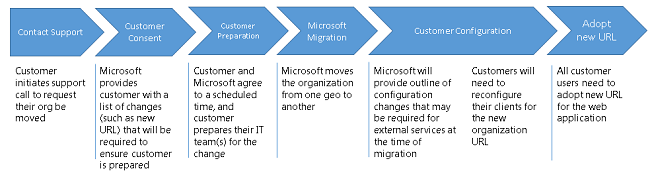

# Datacenter regions

Microsoft hosts Dynamics 365 and Power Platform online services in datacenters across an increasing number of regions. When Microsoft makes these services available in a new region, new organizations get a datacenter that aligns with the macro region you select during environment creation.    
  
For information about datacenter regions for Dynamics 365 and Power Platform, see [Product availability](/dynamics365/get-started/product-availability) and [Where your data is located](https://www.microsoft.com/trust-center/privacy/data-location).  
  
The following list shows regions and their URLs for Dynamics 365 (Dynamics 365 Sales, Dynamics 365 Customer Service, Dynamics 365 Field Service, and Dynamics 365 Marketing).

|Region | URL | 
| ------------- | -------------     | 
| NAM           | crm.dynamics.com  | 
| DEU           | crm.microsoftdynamics.de | 
| SAM           | crm2.dynamics.com | 
| CAN           | crm3.dynamics.com | 
| EUR           | crm4.dynamics.com | 
| APJ           | crm5.dynamics.com | 
| OCE           | crm6.dynamics.com | 
| JPN           | crm7.dynamics.com | 
| IND           | crm8.dynamics.com | 
| GCC           | crm9.dynamics.com | 
| GCC High      | crm.microsoftdynamics.us | 
| GBR           | crm11.dynamics.com | 
| FRA           | crm12.dynamics.com | 
| ZAF           | crm14.dynamics.com | 
| UAE           | crm15.dynamics.com| 
| GER           | crm16.dynamics.com| 
| CHE           | crm17.dynamics.com|  
| CHN           | crm.dynamics.cn | 
| NOR           | crm19.dynamics.com |
| SGP           | crm20.dynamics.com |
| SWE           | crm22.dynamics.com |
| KOR           | crm21.dynamics.com |

## Macro region 
A [macro region](macro-regions.md) represents the data residency boundary that aligns with data residency laws for the given geography. Learn more about the regions available in a specific macro region. 

For more information, see [Power Platform and Dynamics 365 macro regions](macro-regions.md).

## Migration process  
 This section describes the overall process for migrating to a new datacenter.  
  
   
  
 Depending on the type of transition, you might need to complete more steps.  
  
### See also  
 [Geo to geo migrations](geo-to-geo-migrations.md)   
 [Products by region](https://azure.microsoft.com/regions/services/)
