# Tutorial: Automate solution deployment by using GitHub Actions for Microsoft Power Platform

In this tutorial, you learn how to:

> [!div class="checklist"]
> * Create a new GitHub repository
> * Create two GitHub workflows by using GitHub Actions for Microsoft Power Platform

 The workflows can automatically export your app (as an unmanaged solution) from a development environment, generate a build artifact (managed solution), and deploy the app into your production environment. This tutorial uses the [ALMLab solution](https://github.com/microsoft/powerplatform-actions-lab/blob/main/solutions/ALMLab_1_0_0_1.zip) you built and the environments you set up in previous tutorials.

Related tutorials: [Get started](github-actions-start.md), and [Build a model-driven app](github-actions-build.md).

## Create a GitHub account

1. Go to https://github.com and select **Sign up** or **Start a free trial** (or sign in if you have an existing account).

    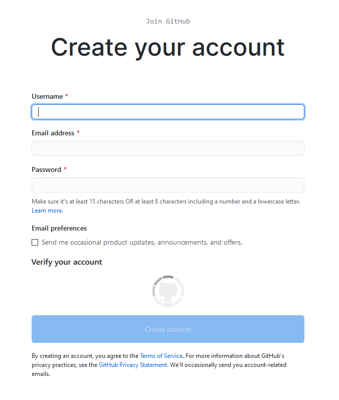

2. After you create your account, create a repository by selecting **Create repository** or **New**.

    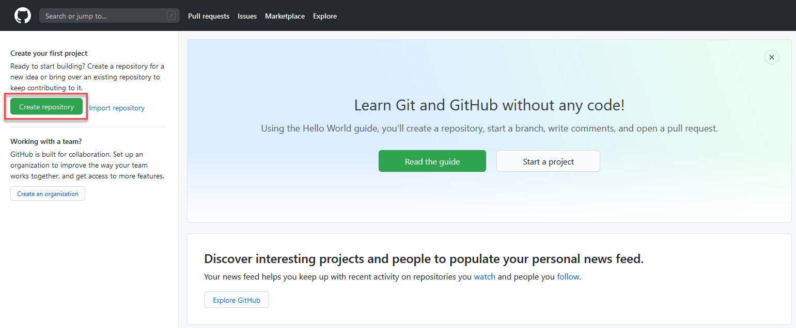

    You might see the following alternative landing screen:

    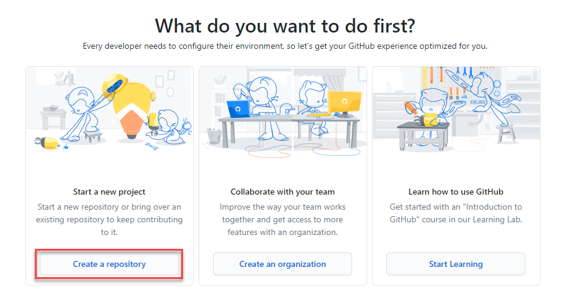

3. Create your new repository and name it `poweractionslab`. Ensure you select **Add a README file** to initiate the repo and choose **Create repository**.

    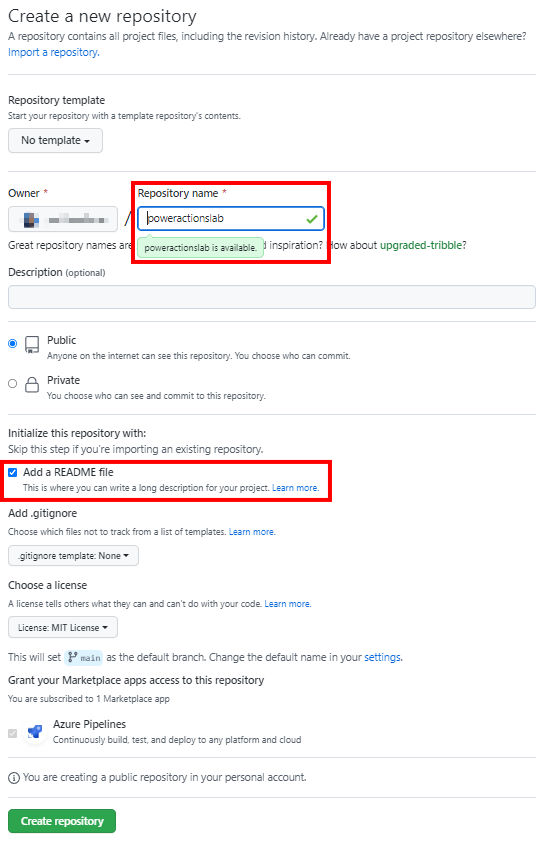

### Creating a new secret for Service Principal Authentication
1. Go to your repository and select **Settings**. Expand **Secrets**, and then select **Actions**.

2. On the *Secrets* page, name the secret `PowerPlatformSPN`. Enter the client secret from the application registration you created in Microsoft Entra into the **Value** field, and then select **Add secret**. You'll reference the client secret in the YML files that define the GitHub workflows later in this tutorial.

    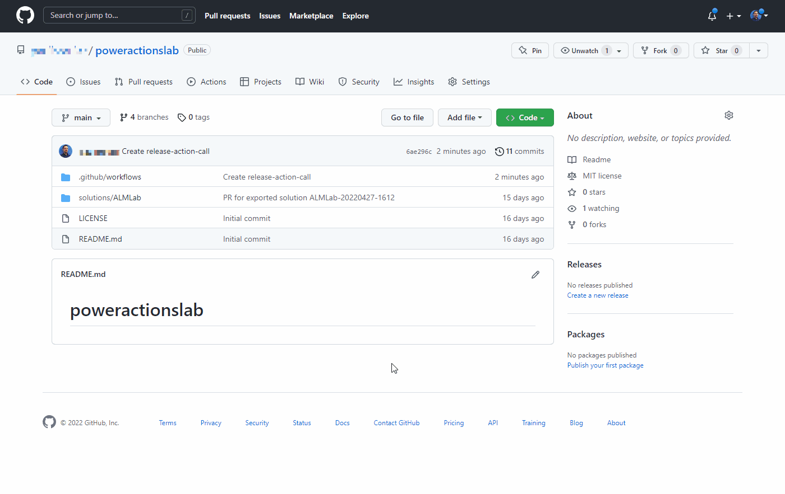

    The client secret is now securely stored as a GitHub secret.

## Create a workflow to export and unpack the solution file to a new branch

1. Select **Actions**, and then select **set up a workflow yourself**. Or, select **Configure** in the *Simple workflow* box under the *suggested for this repository* section.

    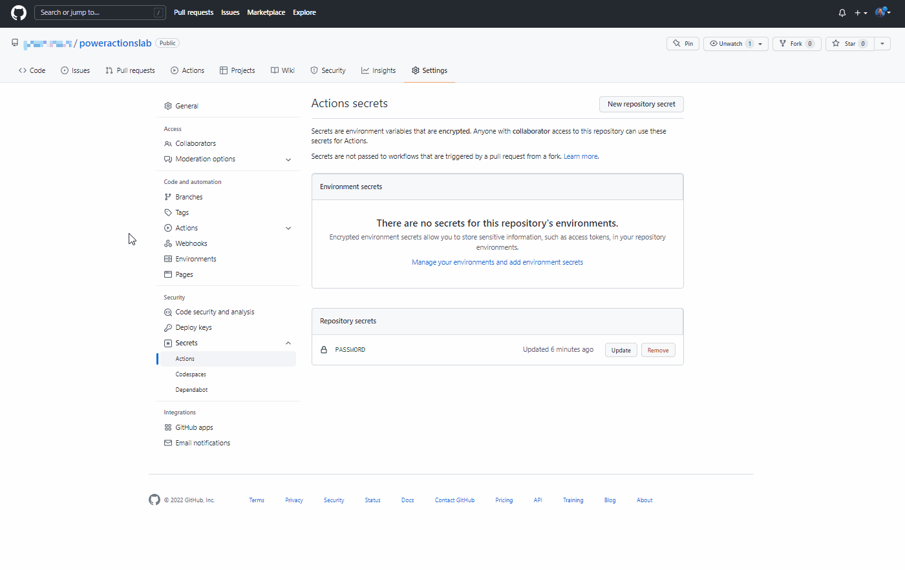

2. You see a new YAML file with a basic workflow to help you get started with GitHub actions.

    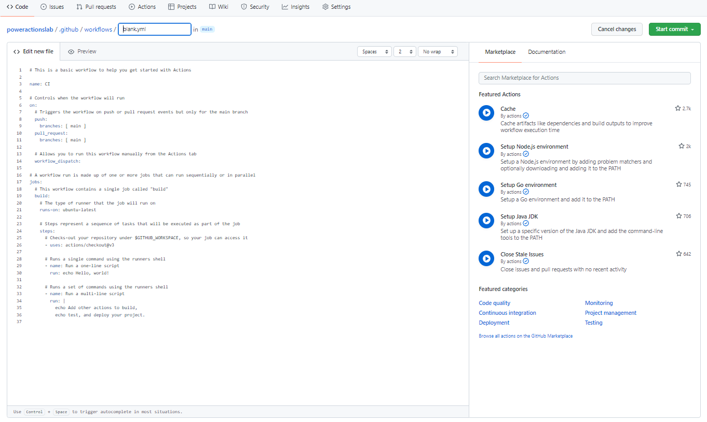

3. Delete the precreated content, and then paste the content from the [export-and-branch-solution-with-spn-auth.yml](https://github.com/microsoft/powerplatform-actions-lab/blob/main/sample-workflows/export-and-branch-solution-with-spn-auth.yml) file. Rename the file to `export-and-branch-solution.yml`.

    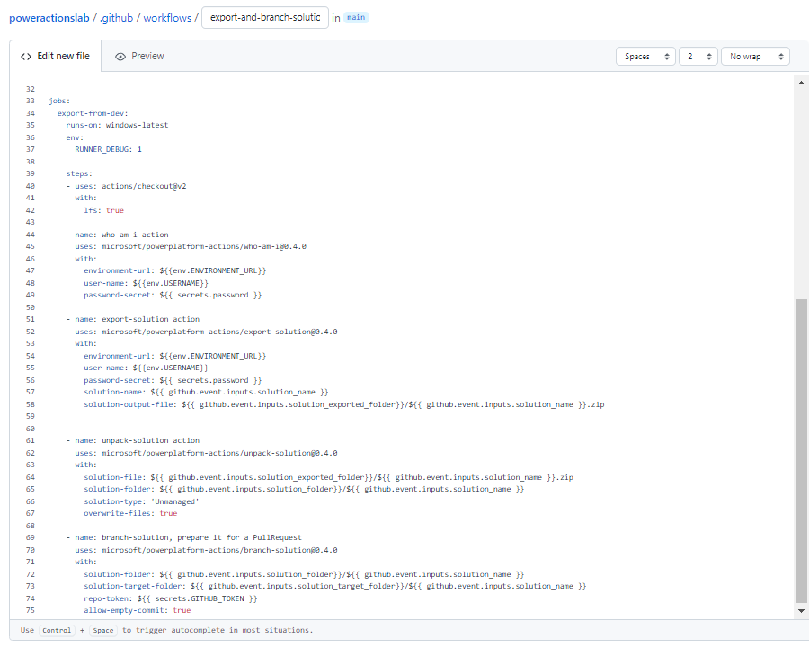

4. Update `<ENVIRONMENTURL>` with the URL for the development environment you want to export from (for example: `https://poweractionsdev.crm.dynamics.com`).

5. Update `<APPID>` and `<TENANT ID>` with your values. 

    * If you use credentials, paste the [export-and-branch-solution.yml](https://github.com/microsoft/powerplatform-actions-lab/blob/main/sample-workflows/export-and-branch-solution.yml) file instead of the *export-and-branch-solution-with-spn-auth.yml* file contents. Update `<USERNAME>` with the username you use to connect to the environment.  

        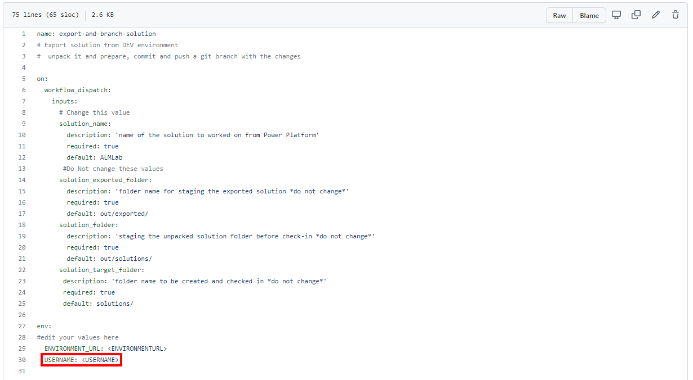

    > [!TIP]
    > If you're not familiar with GitHub Actions and want to learn more, check out the official documentation at https://docs.github.com/en/actions. 

6. You're now ready to commit your changes. Select **Start commit**, type **Create export yml** in the title field, and then add a description (optional). Next, select **Commit new file**.

    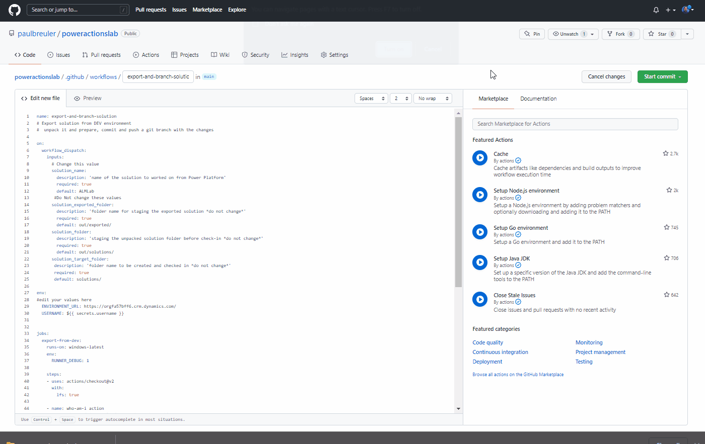

Congratulations, you created your first GitHub workflow by using the following actions:

- **Who Am I**: Ensures that you can successfully connect to the environment you want to export from.
- **Export Solution**: Exports the solution file from your development environment.
- **Unpack Solution**: The solution file that the server exports is a compressed (zip) file with consolidated configuration files. These initial files aren't suitable for source code management because they're not structured to make it feasible for source code management systems to properly do differencing on the files and capture the changes you want to commit to source control. You need to *unpack* the solution files to make them suitable for source control storage and processing.
- **Branch Solution**: Creates a new branch to store the exported solution.

## Test the export and unpack workflow

1. Next, test that the workflow runs. Go to **Actions**, select **Run workflow**, and choose **Run workflow**. If you use a different solution name than `ALMLab`, change the value here but keep the other values the same. 

    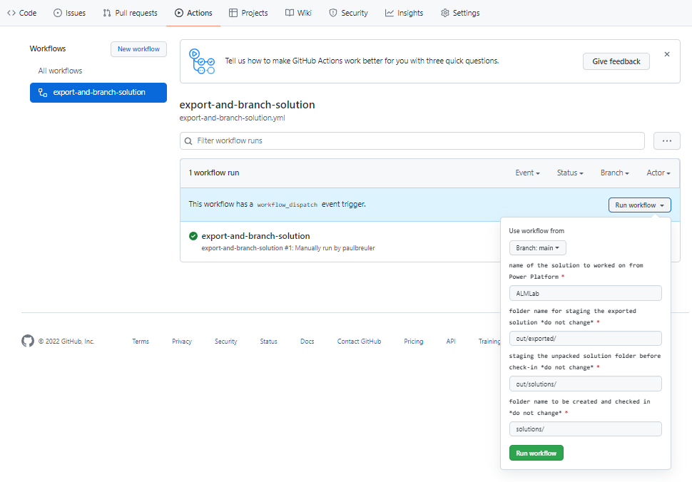

2. After 5–10 seconds, the workflow starts. You can select the running workflow to monitor progress.

    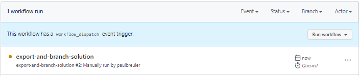

    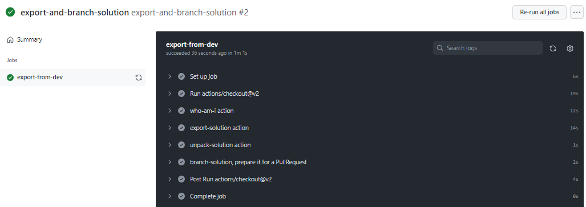

3. After the workflow finishes, check that a new branch is created with the solution unpacked to the `solutions/ALMLab` folder. **Go to the *Code* tab** and **expand the *branches* drop-down**.

4. Select the branch that the action created.

5. Check that the `solutions/ALMLab` folder is created in the new branch. Then, create a pull request to merge the changes into the main branch. **Select *Contribute*** and in the flyout **select *Open Pull request***.

6. On the *Open a Pull request* screen, add a title and description if you want, then **select *Create pull request.***

7. The screen updates to show the new pull request. When you create the pull request, you get confirmation that your branch has no conflict with the main branch. This confirmation means you can merge the changes into the main branch automatically. **Select *Merge pull request***  and then **select *Confirm merge***. Optionally, select delete branch to remove the now defunct branch.

    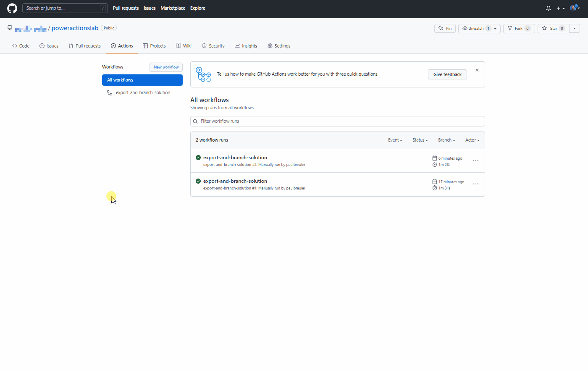

8. Go back to the default (main) branch and check that the solution is available there.

## Create a reusable workflow to generate a build artifact and import to production

In this section, create an additional workflow that:
- Creates a managed solution and publishes it as a GitHub artifact
- Imports the build artifact into the production environment

1. Go to **Actions** and select **New workflow**.

    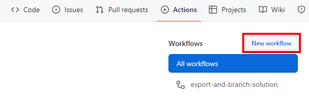

2. Choose **set up a workflow yourself**.

    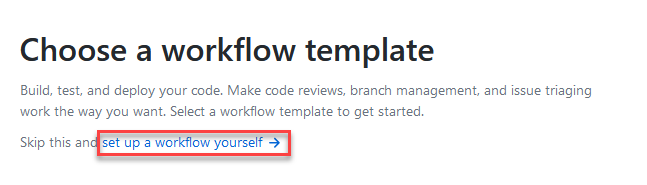

3. Rename the title of the workflow to `release-solution-to-prod-with-inputs`. Copy the content from the [release-solution-to-prod-with-inputs.yml](https://github.com/microsoft/powerplatform-actions-lab/blob/main/sample-workflows/release-solution-to-prod-with-inputs.yml) file and paste it into the **Edit new file** screen.

    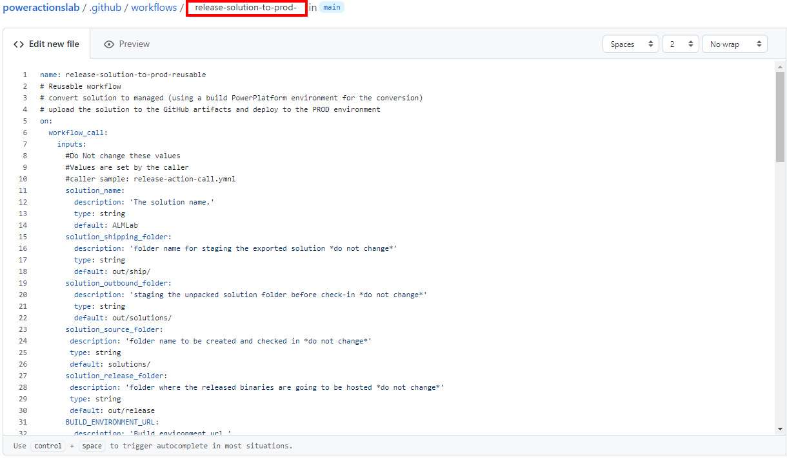

4. Commit the changes. Choose **Start commit** and then add a title and description (optional). Next, select **Commit new file**.

    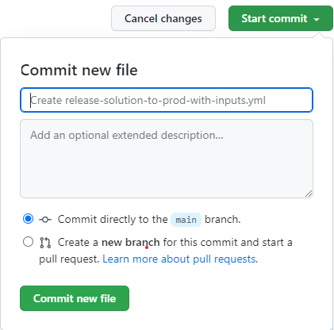

## Call the reusable workflow on the release event

In this section, you call the reusable workflow on the [release event](https://docs.github.com/en/actions/using-workflows/events-that-trigger-workflows#release).

1. Go to **Actions** and select **New workflow**.

    

2. Choose **setup a workflow yourself**.

    

3. Rename the title of the workflow to `release-action-call`. Copy the content from the [release-action-call.yml](https://github.com/microsoft/powerplatform-actions-lab/blob/main/sample-workflows/release-action-call.yml) file and paste it into the **Edit new file** screen.

    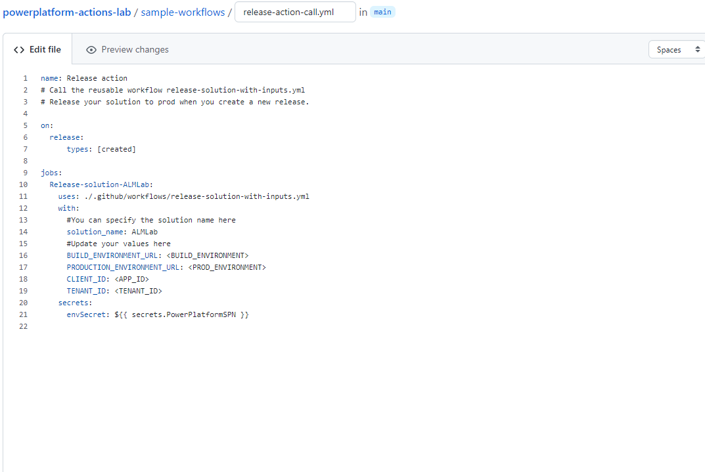

4. Update the following variables in the new workflow file:
    - Update `<BUILD_ENVIRONMENT>` with the URL for the build environment you're using to generate the managed solution. For example: `https://poweractionsbuild.crm.dynamics.com`.
    - Update `<PROD_ENVIRONMENT>` with the URL for the production environment you're deploying to. For example: `https://poweractionsprod.crm.dynamics.com`.
    - Update `<APP_ID>` with the Application (Client) ID that you find in the [App registrations blade of the Microsoft Azure Portal](https://portal.azure.com/#blade/Microsoft_AAD_RegisteredApps/ApplicationsListBlade) by selecting the registration you created earlier in this tutorial.
    - Update `<TENANT_ID>` with the Directory (tenant) ID that you find in the [App registrations blade of the Microsoft Azure Portal](https://portal.azure.com/#blade/Microsoft_AAD_RegisteredApps/ApplicationsListBlade) by selecting the registration you created earlier in this tutorial.

5. Commit the changes. Choose **Start commit** and then add a title (optional) and description (optional). Next, select **Commit new file**.

    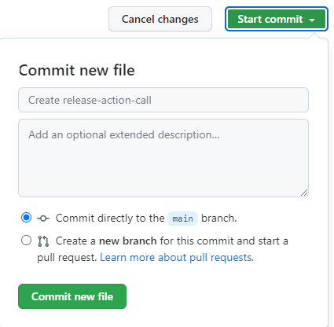

## Test the release to production workflow

You're now ready to test the last workflow. This workflow triggers when a new release is deployed to production.

1. Go to **Releases**.

    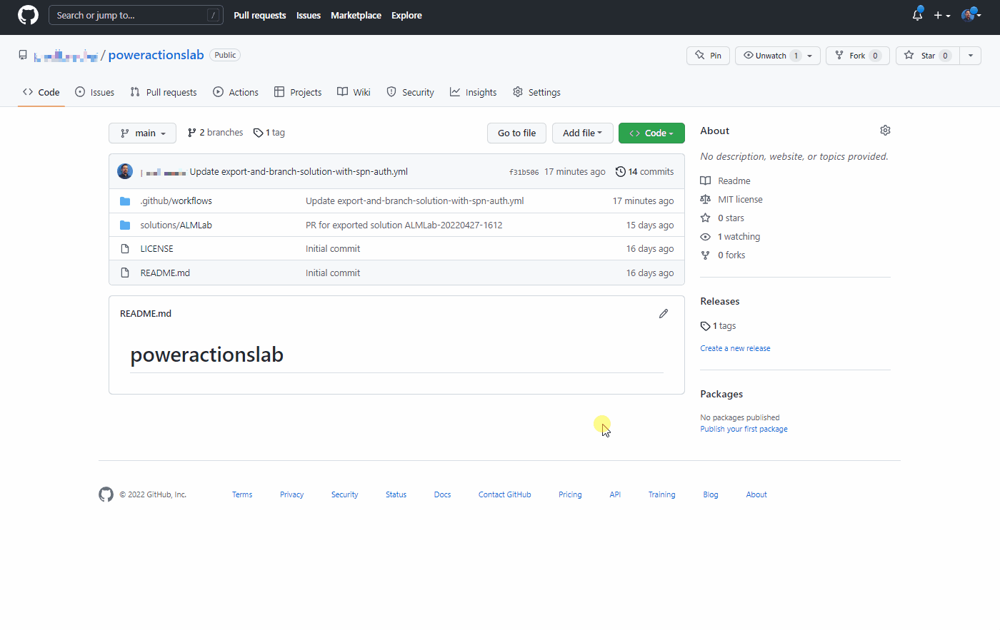

2. Select **Draft a new release**.

3. Add a release tag, a title, and choose **Publish release**.

4. Select **Actions** to view the running workflow.

    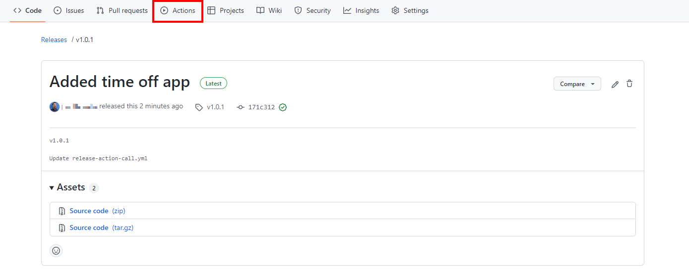

5. Choose the running workflow to view the actions as they run.

    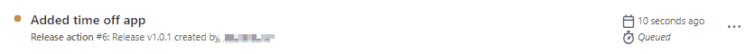

6. Wait for each action to complete.

    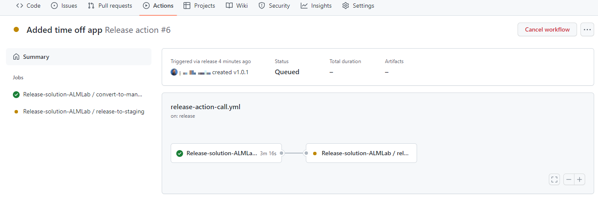

7. After the workflow finishes, sign in to your production environment and validate that the solution is deployed as a managed solution.

## Deploy the update and review changes before production release

Test the end-to-end process, and then see how you can view and validate changes to an app before you deploy it to production.

1. Go to the ALMLab solution in your development environment and select **Edit** or select the solution display name.

    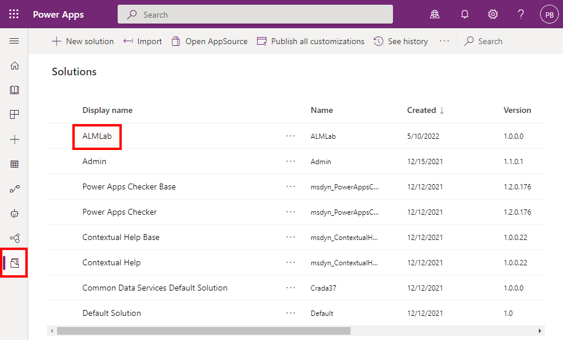

2. Select and view the **Time off Request** table.

    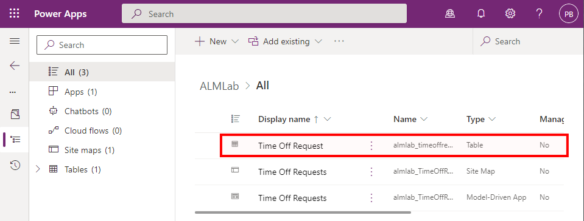

3. Select **+ Add column** and create the new column as shown in the following figure.

    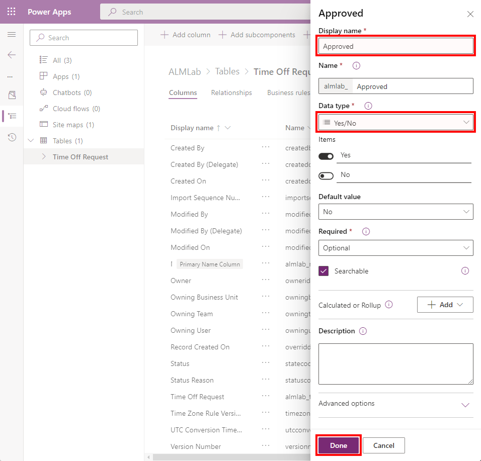

    **Updated Field values**:**

    - **Display name**: Approved
    - **Data type**: Yes/No

4. Select **Done**.

5. Select **Save Table**.
    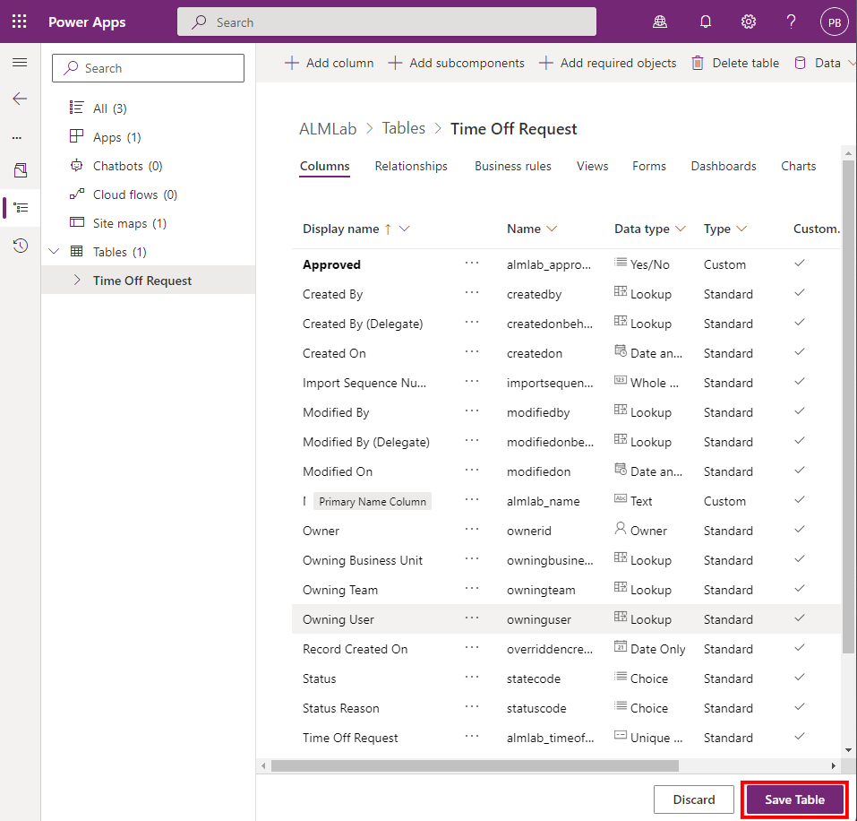

6. Go back to your GitHub repositories **Actions** tab, select **Run workflow**, and select the **Run workflow** button.

    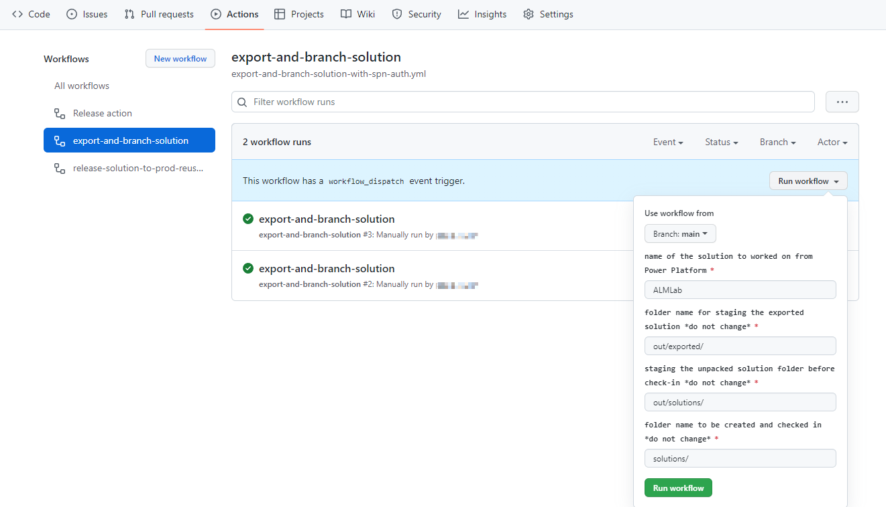

7. After 5–10 seconds, the workflow starts. Select the running workflow to monitor its progress.

    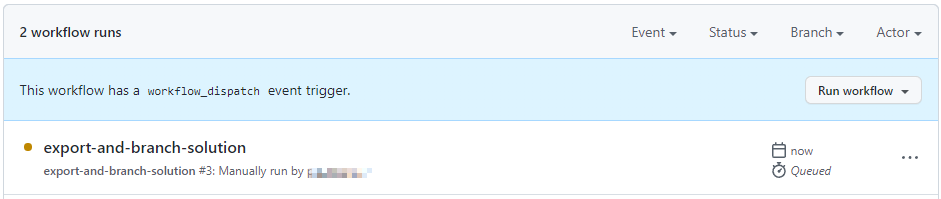

    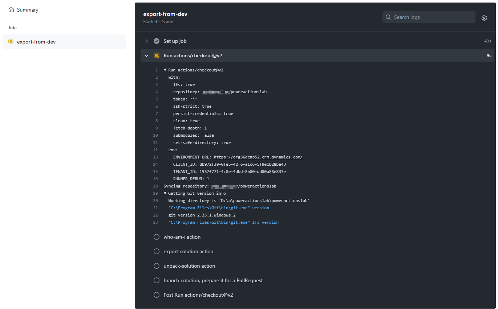

8. After the workflow finishes, go to the new branch by selecting **Code** and then **Branches**.

    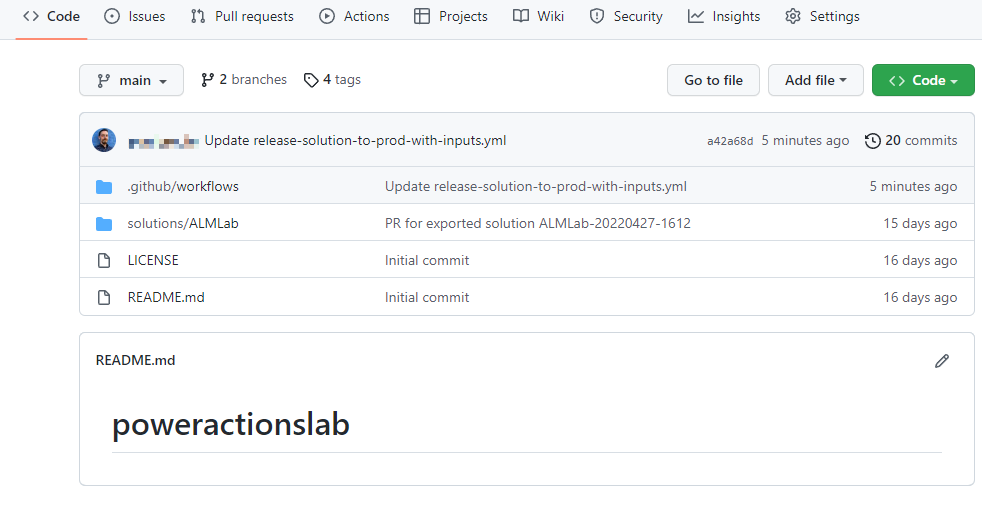

9. Select the branch that you created by expanding **contribute** and selecting **Open pull request**.

10. Add a title (optional) and then select **Create pull request**.

11. After the content updates, select the **Files changed** tab.

12. Notice that the changes to the solution are highlighted in green to indicate that this section of the file was added when compared to the same file in the main branch.

13. Go back to the **Conversation** tab. Select **Pull requests** and then select the pull request you previously created.

14. On the **Pull request** page, select **Squash and merge** to merge the updated solution file into your main branch. Optionally delete that is now merged into main.

     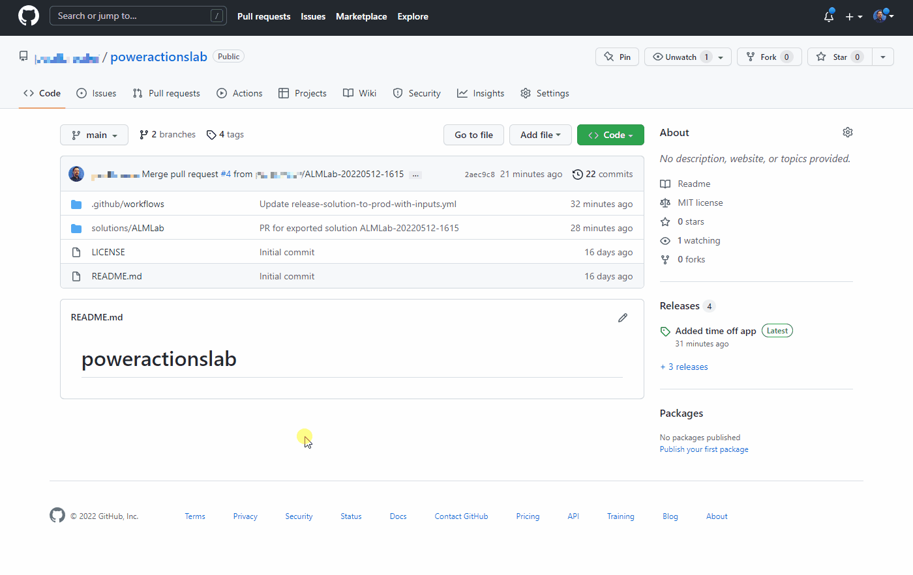

15. Follow the steps in the [Test the release to production workflow](#test-the-release-to-production-workflow) section to create a new release and validate that the updated solution is deployed to your production environment.

Congratulations, you successfully set up a sample CI/CD workflow by using GitHub actions!

### See Also

[Automate your workflow from idea to production](https://github.com/features/actions)

[!INCLUDE[footer-include](../../includes/footer-banner.md)]
