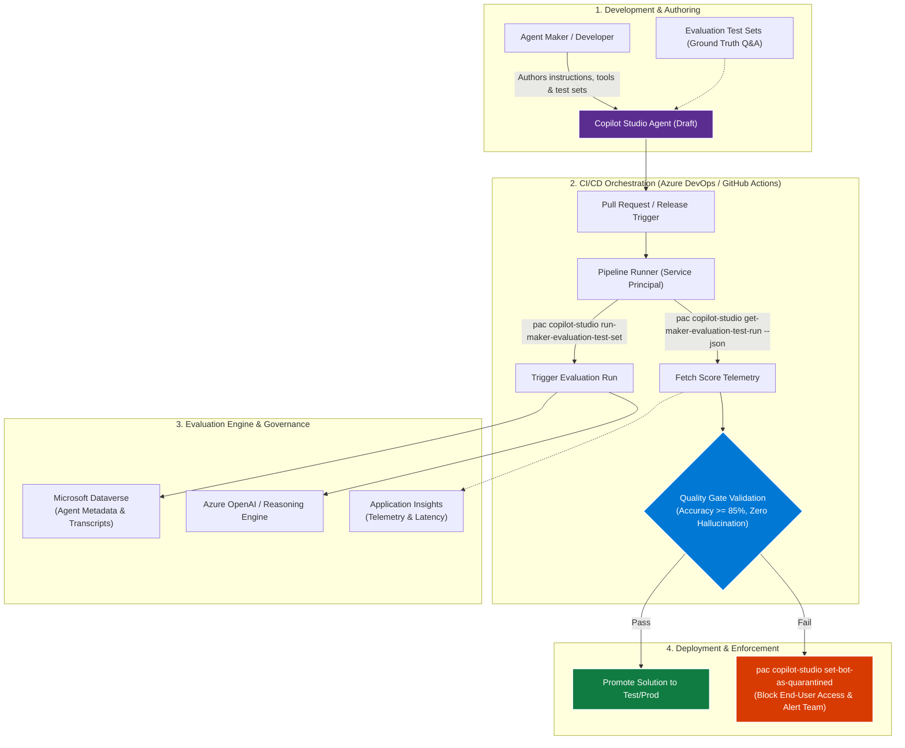

# Automate Copilot Studio agent evaluation and quality gates in CI/CD

In this article, you learn how to implement automated agent evaluation, regression testing, and quality gates for Microsoft Copilot Studio agents within continuous integration and continuous deployment (CI/CD) pipelines. By combining Copilot Studio evaluation test sets with the Microsoft Power Platform CLI (`pac copilot-studio`), organizations can eliminate subjective manual testing, verify grounding accuracy against enterprise knowledge sources, and enforce automated release policies before promoting agents to production.

[!INCLUDE [pp-arch-solution-idea-tip](../../includes/pp-arch-solution-idea-tip.md)]

## Architecture diagram



## Workflow

The automated evaluation and quality gate workflow follows a continuous delivery lifecycle:

### Phase 1: Test set curation and versioning
1. **Curate ground-truth test sets:** Makers define test sets inside Copilot Studio containing question-and-answer pairs, target entity extractions, expected tool calls (such as agent flows or connectors), and expected citation sources.
2. **Commit with solution metadata:** The agent definition and test set references are packaged as solution assets in Microsoft Dataverse and committed to source control (Git repository).

### Phase 2: Pipeline execution
1. **Trigger on pull request:** A pull request or scheduled release pipeline triggers in Azure DevOps or GitHub Actions using an Entra ID application registration with workload identity federation.
2. **Execute automated evaluation run:** The pipeline runner invokes the Microsoft Power Platform CLI command:
   ```bash
   pac copilot-studio run-maker-evaluation-test-set \
     --environment $TARGET_ENV \
     --bot-id $BOT_ID \
     --test-set-id $TEST_SET_ID \
     --evaluation-run-name "PR-$(Build.BuildId)"
   ```
3. **Poll and extract telemetry:** The runner polls the evaluation status until completion using:
   ```bash
   pac copilot-studio get-maker-evaluation-test-run \
     --environment $TARGET_ENV \
     --bot-id $BOT_ID \
     --test-run-id $RUN_ID \
     --json
   ```

### Phase 3: Automated quality gate enforcement
1. **Evaluate against quality thresholds:** The pipeline parses the structured evaluation JSON response and tests against enterprise governance thresholds:
   - **Semantic Similarity / Accuracy:** Minimum pass rate (for example, $\ge 85\%$).
   - **Grounding and Citation Compliance:** 100% of generative responses must map to authorized corporate knowledge sources.
   - **Tool Invocation Integrity:** Verifies that agent flows and connectors were called with correct input parameters without unexpected fallback.
2. **Automated promotion or quarantine:**
   - **If thresholds pass:** The pipeline automatically packages the managed solution and proceeds with the promotion release into staging or production environments.
   - **If thresholds fail:** The pipeline blocks deployment, notifies the development team with the failed transcript traces, and optionally invokes `pac copilot-studio set-bot-as-quarantined` to prevent untested or ungrounded agents from responding in shared enterprise channels.

## Components

- [**Microsoft Copilot Studio**](/microsoft-copilot-studio/): The low-code conversational and autonomous agent authoring platform where makers build topics, connect knowledge sources, configure agent flows, and manage evaluation test sets.
- [**Power Platform CLI (`pac copilot-studio`)**](/power-platform/developer/cli/reference/copilot-studio): Provides developer and DevOps command groups (`run-maker-evaluation-test-set`, `get-maker-evaluation-test-run`, `set-bot-as-quarantined`) to automate agent execution, test extraction, and quarantine management.
- [**Azure DevOps Pipelines**](/azure/devops/pipelines/) / [**GitHub Actions**](https://docs.github.com/actions): Orchestrates the automated build pipeline, executes CLI commands, evaluates quality gate rules, and manages deployment lifecycles.
- [**Microsoft Dataverse**](/power-apps/maker/data-platform): Stores the core agent configuration, solution components, test set definitions, and execution run history securely within tenant environments.
- [**Application Insights**](/azure/azure-monitor/app/app-insights-overview): Ingests runtime telemetry, response latencies, user escalation deflection rates, and custom trace events generated during test execution.

## Scenario details

As organizations scale agentic AI across business units, maintaining high response quality and preventing regression becomes a primary challenge. Minor revisions to an agent's system prompt, topic trigger phrases, or underlying enterprise knowledge base (such as updated SharePoint documentation or product PDFs) can unintentionally cause:
- **Prompt regressions:** The agent fails to answer previously supported questions.
- **Hallucinations:** Generative responses provide ungrounded answers when knowledge base citations fail.
- **Broken tool integrations:** Dynamic orchestration fails to pass required parameters to Power Automate cloud flows or custom connectors.

Manually reviewing agent answers before every release is labor-intensive and cannot catch subtle drift across hundreds of conversation variations. By implementing an automated evaluation pipeline, teams treat agent instructions and knowledge sources with the same engineering rigor as application source code, catching defects early in the development lifecycle before they reach customer-facing channels.

## Considerations

[!INCLUDE [pp-arch-ppwa-link](../../includes/pp-arch-ppwa-link.md)]

### Reliability
- **Deterministic test sets:** Build test sets that reflect common and edge-case user prompts to establish repeatable baselines across release cycles.
- **Transient error handling:** Implement retry policies in the pipeline polling script to handle temporary capacity throttling during heavy test runs.
- **Draft vs. published isolation:** Run evaluations against draft bot instances (`--run-on-published-bot false`) in dedicated build environments to ensure zero impact on production workloads.

### Security
- **Least privilege access:** Authenticate CI/CD pipeline service principals using Microsoft Entra ID workload identity federation with scope restricted to the specific build environment.
- **Quarantine protection:** Use `pac copilot-studio set-bot-as-quarantined` as an automated circuit breaker when unexpected security or compliance vulnerabilities are detected during test runs.
- **Connection credential isolation:** Store connector connection references and credentials securely in Azure Key Vault or Dataverse secure environment variables rather than pipeline scripts.

### Operational Excellence
- **Standardized ALM:** Decouple agent authoring from manual deployment by embedding evaluation directly into solution pack and unpack workflows.
- **Automated regression prevention:** Block pull requests automatically when an evaluation run score falls below historical baseline thresholds.
- **Continuous monitoring:** Export evaluation telemetry to Azure Log Analytics to monitor test score trends and latency profiles over time.

### Performance Efficiency
- **Targeted test sets:** Segment test sets by domain (for example, general FAQs vs. complex transactional topics) to optimize pipeline execution speed.
- **Concurrent execution:** Run independent topic evaluations in parallel across separate pipeline stages to minimize build wait times.

### Experience Optimization
- **Consistent quality:** End users experience reliable, grounded answers with accurate citations and seamless tool execution.
- **Rapid feedback for makers:** Developers receive detailed test run failure reports within minutes of submitting changes, identifying the exact prompt and topic that regressed.

## Responsible AI

- **Hallucination detection:** Evaluation test sets verify that generative answers are strictly grounded in authorized corporate knowledge repositories.
- **Fairness and bias mitigation:** Test sets include diverse phrasing, dialects, and user intents to ensure equitable agent performance across different user groups.
- **Transparency and explainability:** Automated evaluation results record the exact knowledge source documents cited for every response in the test run.
- **Accountability:** Full traceability links each evaluation test run directly to the Git commit hash and pull request author.

## Contributors

_Microsoft maintains this article. The following contributors wrote this article._

Principal authors:

- [Sapan Patel](https://github.com/sapanpatel1230), Power Platform & Copilot Studio Solutions Architect

## Related resources

- [Microsoft Power Platform CLI copilot-studio command group](/power-platform/developer/cli/reference/copilot-studio)
- [Evaluate your Copilot Studio agent with maker evaluation](/microsoft-copilot-studio/analytics-agent-evaluation-create)
- [Copilot Studio reference architectures and solution ideas](/power-platform/architecture/products/copilot-studio)
- [Application lifecycle management (ALM) with Microsoft Power Platform](/power-platform/alm/)
