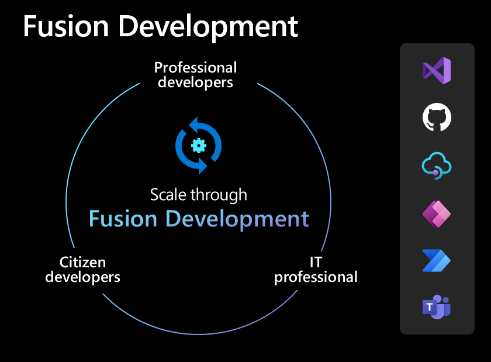
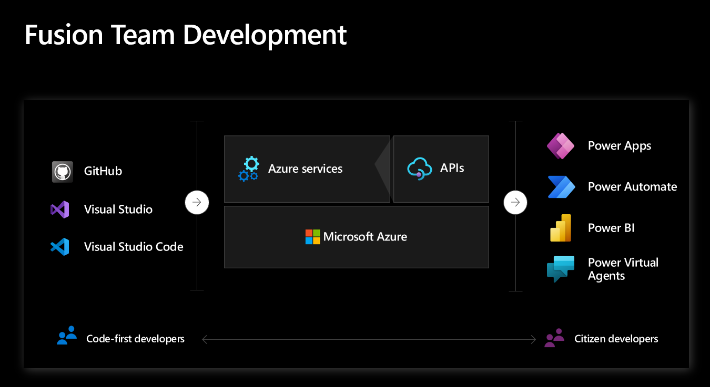

# Fusion development in Power Platform

Gartner defines fusion development or fusion teams development as "distributed and multidisciplinary digital business teams that blend technology and other types of domain expertise." (Source: 2019 Gartner Digital Business Teams Survey) 

Fusion development is an approach that aims to scale application development through low-code. By using fusion development, your business can build better applications faster by bringing together professional developers with citizen, or low-code, developers. Fusion development can also mean using low-code capabilities and combining them with code-first components to meet business needs and create fusion applications.

## Personas for fusion development

The following table describes the personas in a fusion team:

| Persona | Description |
| ---- | ---- | 
| Citizen developer or maker | A business user with business knowledge looking for ways to improve a business process. Uses visual, drag and drop, and low-code tools. Usually doesn't have a technical background. |
| Professional developer or code-first developer | Pro devs use pro dev tools to accomplish pro dev tasks. For example, they write code in Visual Studio or Visual Studio Code by using programming languages like C# or JavaScript. |
| IT professional or DevOps engineer | An IT professional responsible for the application lifecycle management (ALM) of business applications. |

> [!IMPORTANT]
> The goal is to empower diverse groups of people with different skill sets and boost velocity by scaling solution development through low-code. The Microsoft Power Platform is a tool in your tool set. It helps you work more efficiently and focus on tasks that match your desired skill level.

By empowering citizen developers, pro developers can focus on specialized problems and avoid simple and repetitive tasks that citizen developers can perform.

## Collaboration

Power Platform is designed to empower fusion teams, so three key audiences can come together.

](media/fusion-team.png "Fusion team")

> [!TIP]
> Low-code and pro-dev tools should integrate smoothly to enable different groups of people to work together effectively.

The role of the professional developer and IT professional is to create a secure and governed environment where citizen developers can be empowered to achieve more with minimum friction. Everyone should use citizen maker tools to accomplish citizen maker tasks. For example, pro devs use the same visual tooling as citizen makers when creating apps on Power Platform.

### See Also

[Create a developer environment](create-developer-environment.md) 
[Fusion Development ebook](/power-apps/guidance/fusion-dev-ebook/)  
[Power Platform ALM for developers](../alm/alm-for-developers.md) 
[Power Platform for developers](get-started.md)

[!INCLUDE[footer-include](../includes/footer-banner.md)]
